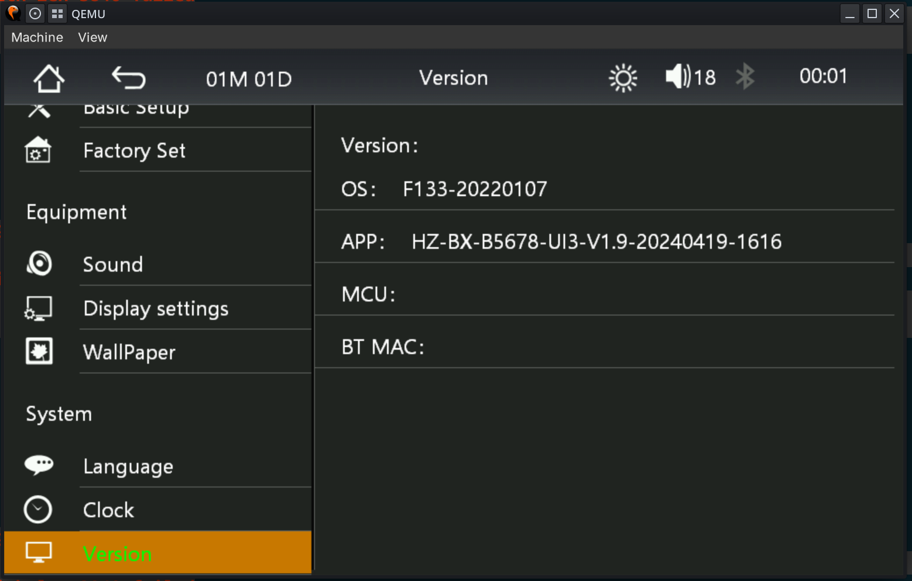
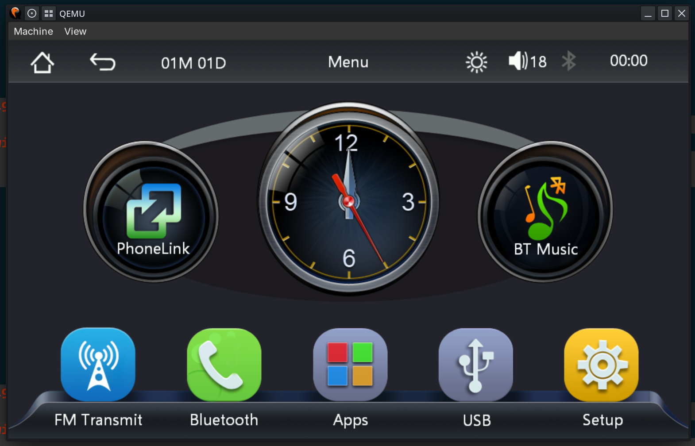

# F133 emulator

Qemu platform support for cheap RISC-V Allwinner F133 based radios.

Given SPI flash dump, it can emulate the firmware entirely, including touchscreen and USB.

Short term goal is for pentesting and seeing if custom code execution is possible.

